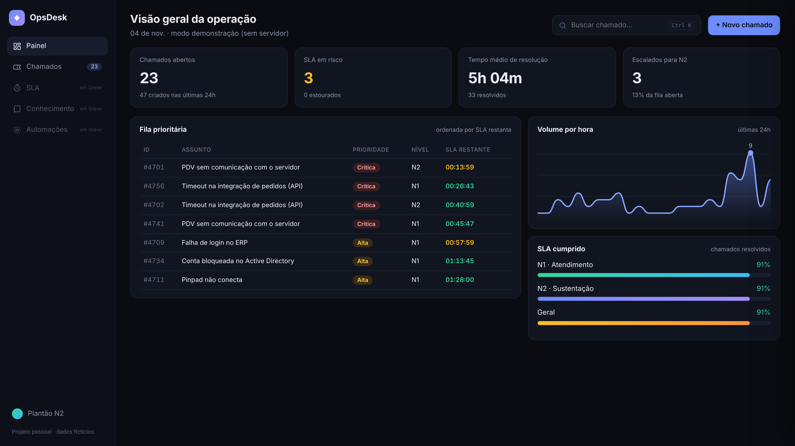

# OpsDesk

Service desk de demonstração com **SLA em tempo real**, **escalonamento N1 → N2** e quadro de chamados.
Projeto pessoal, com **dados fictícios** — não representa sistema de nenhuma empresa.

[](https://github.com/euguisantosdev/opsdesk/actions/workflows/tests.yml)



| Quadro de chamados | Detalhe com histórico e SLA |
|---|---|
|  |  |

## O que o sistema faz

- **Ciclo do chamado:** Novo → Em atendimento → Aguardando usuário → Resolvido, com histórico (quem fez o quê e quando).
- **Motor de SLA por prioridade:** Crítica 1h · Alta 4h · Média 8h · Baixa 24h. O relógio **pausa** enquanto o chamado aguarda o usuário e **para** ao resolver. Abaixo de 25% do prazo o chamado entra em **risco**; passou do prazo, **estourado**.
- **Escalonamento N1 → N2** só com evidências registradas; **resolver** exige a descrição da solução.
- **Quadro com arrastar e soltar** (transições inválidas são recusadas) e painel com indicadores.
- **API JSON** (`/api/tickets`, `/api/tickets/{id}/transition`, `/api/tickets/{id}/escalate`, `/api/metrics`).

## Arquitetura

```
web/ (HTML + CSS + JS puro)  ──fetch──►  opsdesk/server.py (API JSON, http.server)
                                              │
                                  opsdesk/service.py  (regras: ciclo, escalonamento, métricas)
                                  opsdesk/sla.py      (cálculo de SLA, funções puras)
                                              │
                                          SQLite (data/opsdesk.db, criado e populado na 1ª execução)
```

Sem dependências externas: apenas a biblioteca padrão do Python. Sem a API, a página roda em **modo demonstração** com `web/demo-data.json`.

## Como rodar

```bash
python -m opsdesk.server        # abre em http://127.0.0.1:8000
```

Testes (32 testes de SLA, ciclo do chamado e API):

```bash
pip install -r requirements-dev.txt
python -m pytest -q
```

Gerar de novo os dados da demonstração: `python export_demo.py`.

## Decisões de projeto

- **Regras de negócio em Python puro e testadas**, separadas da interface; o front só exibe e chama a API.
- **SQL direto (sqlite3)** para ficar explícito o modelo de dados (`tickets` e `events`).
- **Segurança básica:** consultas parametrizadas, escape de HTML no front e bloqueio de caminhos fora de `web/`.

## Próximos passos

Base de conhecimento ligada aos chamados, log de auditoria detalhado e integração com o [SRE Auto-Heal](https://github.com/euguisantosdev/sre-autoheal).
